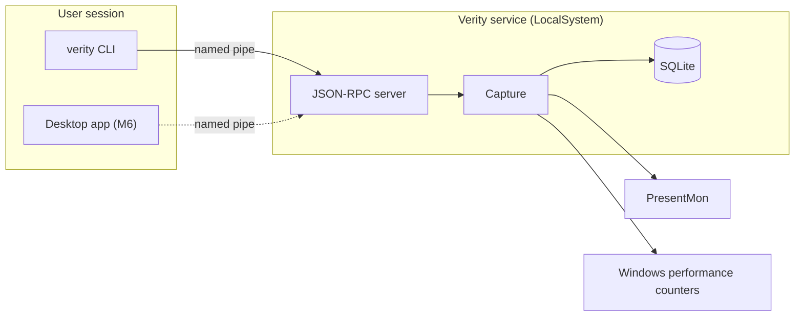

<div align="center">

# Verity

**A Windows performance tool for games and everyday use. It measures first, changes second, and proves every change on your machine.**

[](#requirements)
[](https://www.rust-lang.org/)
[](LICENSE)
[](#project-status)

</div>

---

Most "PC optimizers" and "game boosters" apply a fixed list of tweaks blindly. They don't know what is wrong with your
machine, they never measure before and after, and many of their tweaks do nothing or make things
worse. You end up with a changed system and no evidence.

Verity closes the loop: **measure → attribute → act → verify**. It records how your PC actually
runs, in games and in everyday work, works out what is slowing it down, changes only what is relevant, temporarily and
reversibly, and keeps a change only if it measurably helped. When it can't show an effect, it says
so.

> [!WARNING]
> **Verity is in early development and is not ready for everyday use.** The measurement engine
> works; diagnosis, optimization and the desktop app are still being built. See
> [Project status](#project-status).

## Contents

- [Features](#features)
- [Design principles](#design-principles)
- [How it works](#how-it-works)
- [Getting started](#getting-started)
- [Usage](#usage)
- [Development](#development)
- [Project status](#project-status)
- [Documentation](#documentation)
- [Contributing](#contributing)
- [License](#license)

## Features

| | Feature | What it does | Status |
|---|---|---|---|
| 📈 | **Frame capture** | Records every presented frame of a running game or app: average FPS, 1% and 0.1% lows, pacing, and stutters (hitches). | ✅ Working |
| 🎯 | **GPU attribution** | Tells you which GPU a game is really rendering on, without touching the game. Catches the classic "laptop game running on integrated graphics". | ✅ Working |
| 🩺 | **Doctor** | Finds the problems that cost real performance: wrong GPU, display stuck at 60 Hz, a charger that can't keep up, thermal throttling, background hogs, slow startup apps. Every finding comes with numbers. | 🔜 Next (M2) |
| 💻 | **Everyday PC** | Measures what you notice when no game is running: desktop smoothness, apps freezing, slow boot, background work draining the battery, audio crackles from driver latency. | 📋 Planned (after M1, M2, M5) |
| ↩️ | **Reversible actions** | Every change is journaled before it is made and can be undone one at a time, per session, or all at once, even after a crash or power cut. | 📋 Planned (M3) |
| 🎮 | **Session Mode** | Applies a profile when a game, or any app you choose, starts and puts everything back when it exits. Background work is slowed down, never killed. | 📋 Planned (M4) |
| 🔍 | **Frame Story** | Matches each stutter to what the system was doing at that moment: a driver, a background process, a virus scan, a power change. | 📋 Planned (M5) |
| 🖥️ | **Desktop app** | Window, timeline charts and a tray icon. | 📋 Planned (M6) |
| 🧪 | **The Lab** | Randomized A/B tests with real statistics. The verdict is *improves*, *hurts*, *no measurable effect* or *inconclusive*. | 📋 Planned (M7) |

## Design principles

These are binding rules, not aspirations. Code that breaks one is treated as a bug. The full list
is in [`docs/09-safety.md`](docs/09-safety.md).

- **Evidence over folklore.** No optimization ships without a way to measure its effect on your machine.
- **Temporary over permanent.** Changes are session-scoped by default and undone automatically.
- **Throttle, don't kill.** Background work is steered with Windows' own scheduling tools; nothing is killed by default.
- **Hands off your games and apps.** Verity never reads or writes another program's memory, injects code, hooks, installs a kernel driver or modifies game files. It observes passively through system-wide events, which also keeps it out of anti-cheat territory.
- **No snake oil.** RAM cleaners, "debloat" scripts, mass service disabling, registry tweak packs and the like are blacklisted, with the reason for each.
- **Honest output.** No fake scores, no invented percentages. If there is no measurable effect, Verity says so.
- **Fully offline.** No accounts, no telemetry upload, no network connections. All data stays on your machine.

## How it works



- A **Windows service** does the privileged work: capture, and later diagnosis and reversible changes. It accepts requests from user-level clients over a named pipe with a strict access list, and treats every client as untrusted.
- **Frames** come from [PresentMon](https://github.com/GameTechDev/PresentMon), Intel's open-source frame-timing tool, run as a child process. It reads system-wide graphics events, so no handle to the program being measured is ever opened. Its binary is hash-checked before every launch.
- **System counters** (CPU, memory, per-process GPU engine use) are sampled once a second through Windows' performance counters.
- **Sessions** are stored in SQLite, with frames compressed in roughly ten-second chunks.

Details: [`docs/02-architecture.md`](docs/02-architecture.md) and [`docs/03-telemetry.md`](docs/03-telemetry.md).

## Getting started

### Requirements

- Windows 10 22H2 or Windows 11, x64
- [Rust](https://rustup.rs/) (stable, `x86_64-pc-windows-msvc`)
- [Visual Studio Build Tools 2022](https://visualstudio.microsoft.com/downloads/#build-tools-for-visual-studio-2022) with the **Desktop development with C++** workload
- Git
- Administrator rights, to install the service and to capture frames

### Build

```powershell
git clone https://github.com/saaddahub/VERITY.git
cd VERITY
cargo build --workspace
```

### Get PresentMon

PresentMon is not committed to the repository. Download the pinned version into `tools/presentmon/`
and check its hash:

```powershell
Invoke-WebRequest https://github.com/GameTechDev/PresentMon/releases/download/v2.6.0/PresentMon-2.6.0-x64.exe `
  -OutFile tools\presentmon\PresentMon-2.6.0-x64.exe
(Get-FileHash tools\presentmon\PresentMon-2.6.0-x64.exe).Hash
```

The hash must be `B2A706BC6AD475749E3B7E3409263AA1E6906D45BDCF993F6DBC0F660188F1AF`. Verity refuses
to run any other build.

### Install the service

From an **elevated** terminal (Run as administrator):

```powershell
.\target\debug\verity.exe service install
.\target\debug\verity.exe service start
```

`install` copies the service and PresentMon into `C:\Program Files\Verity`, a folder standard users
can't write to, and registers the service there. To remove everything:

```powershell
.\target\debug\verity.exe service uninstall
```

Recorded data stays in `C:\ProgramData\Verity` until you delete it.

## Usage

```text
verity system info [--json]
verity record --pid <pid> | --exe <name> [--duration <seconds>]
verity sessions list
verity sessions show <id> [--json]
verity sessions export <id> --csv <path>
verity service install | start | stop | uninstall
```

Record a game or app until it exits (or pass `--duration`):

```console
> verity record --exe framegen.exe
recording until the process exits...
Session 4 — framegen.exe (pid 13672), 2026-11-14T12:25:35Z
  Captured  35.7 s, 2026 frames; the first 5 s are left out of the numbers below
  Average   58.6 FPS over 29.5 s
  Lows      1%: 15.0 FPS   0.1%: 15.0 FPS
  Pacing    0.08 ms spread
  Hitches   20 (40.6 per minute), worst 66.8 ms
  GPU       Intel(R) UHD Graphics
  Overhead  0.179% CPU (budget 0.30%)
```

This is a real run on the development laptop, against the test tool `framegen` with 20 stutters
planted on purpose. Verity found all 20 and nothing else. *Lows* describe the slowest 1% and 0.1%
of frames, so planted 67 ms stutters pull them down to about 15 FPS while the average stays near 60.

## Development

### Checks

A change is done only when build, tests, clippy and formatting all pass:

```powershell
.\tools\check.ps1
```

Tests that install the real service or capture frames need administrator rights and are skipped by
default. Run them from an elevated terminal:

```powershell
.\tools\check.ps1 -Admin
```

The end-to-end test records `framegen` and checks Verity's results against framegen's own log of
when each stutter was planted.

### Test tools

| Tool | Purpose |
|---|---|
| `framegen` | A synthetic "game": a Direct3D 11 window at a set frame rate, with stutters planted at known times and logged as ground truth. |
| `stress` | Load generators: `cpu`, `disk`, `mem`, and a do-nothing `decoy` process used as a false-positive control. |
| `probes` | Small programs that check how Windows actually behaves on this machine before the code relies on it. |

### Project structure

```text
apps/
  verity-cli/         command-line client
  verity-service/     Windows service host and IPC methods
crates/
  verity-core/        domain types, OS traits, frame metrics
  verity-sys/         all unsafe code and Win32 calls, behind safe wrappers
  verity-ipc/         JSON-RPC protocol, named-pipe server and client
  verity-telemetry/   PresentMon capture and parsing
  verity-store/       SQLite schema and compressed chunk storage
  verity-doctor/      diagnostic rules            (stub, M2)
  verity-actions/     reversible actions          (stub, M3)
  verity-session/     game detection, profiles    (stub, M4)
  verity-story/       stutter attribution         (stub, M5)
  verity-lab/         A/B experiments             (stub, M7)
tools/
  framegen/  stressors/  probes/  presentmon/
docs/                 specification, decisions and status
```

All `unsafe` code and raw Windows API calls live in `verity-sys`. Everything above it is safe Rust
and talks to the OS through traits, so the logic can be unit-tested with fakes.

## Project status

Verity is built in ten milestones, each with acceptance criteria that must pass before the next one
starts. The full plan is in [`docs/11-roadmap.md`](docs/11-roadmap.md); what works today, and how it
was verified, is in [`docs/notes/STATUS.md`](docs/notes/STATUS.md).

| Milestone | Scope | Status |
|---|---|---|
| M0 | Skeleton: service, IPC, system info | ✅ Done |
| M1 | Telemetry: frame capture, metrics, sessions | ✅ Automated criteria pass; real-game check open |
| — | Desktop smoothness capture (`record --desktop`) | 📋 Planned, right after M1 |
| M2 | Doctor: diagnostic rules, for gaming and everyday use | 🔜 Next |
| M3 | Actions and journal | |
| M4 | Session Mode, for games and chosen apps | |
| M5 | Frame Story | |
| M6 | Desktop app | |
| M7 | The Lab | |
| M8 | Remaining rules and actions, strict passive mode | |
| M9 | Installer, signing, release | |

Where the implementation had to differ from the specification, the change and the reason are
recorded in [`docs/notes/decisions.md`](docs/notes/decisions.md).

## Documentation

| Document | Contents |
|---|---|
| [Vision](docs/01-vision.md) | What Verity is, why it is different, what it will never do, everyday use |
| [Architecture](docs/02-architecture.md) | Processes, crates, IPC, storage schema, timekeeping |
| [Telemetry](docs/03-telemetry.md) | Frame pacing, system counters, kernel tracing |
| [Doctor](docs/04-doctor.md) | Diagnostic rules |
| [Actions](docs/05-actions.md) | Optimization catalog and the reversible Action framework |
| [Session Mode](docs/06-session-mode.md) | Game detection, profiles, auto-apply and auto-revert |
| [Frame Story](docs/07-frame-story.md) | Stutter forensics |
| [The Lab](docs/08-lab.md) | A/B experiments and statistics |
| [Safety](docs/09-safety.md) | Reversibility, anti-cheat rules, the snake-oil blacklist |
| [UI](docs/10-ui.md) | Screens, tray behavior, design direction |
| [Roadmap](docs/11-roadmap.md) | Milestones, acceptance criteria, test strategy |
| [Working with Claude Code](docs/working-with-claude-code.md) | The spec-driven workflow used to build Verity |

## Contributing

1. Read [`CLAUDE.md`](CLAUDE.md) (the project's standing rules) and [`docs/09-safety.md`](docs/09-safety.md).
2. Work on a branch named for the milestone or change, and keep to the milestone in progress.
3. Run `.\tools\check.ps1` before every commit, and `.\tools\check.ps1 -Admin` when you touch the service or capture.
4. If Windows behaves differently from the spec, write a probe in `tools/probes/`, make the code match reality, update the spec, and add an entry to `docs/notes/decisions.md`.
5. State the reason for any new dependency in the commit message.

Test only on your own machine until the release milestone: Verity will change system settings from
M3 on, and early builds will have bugs.

## License

Verity is licensed under the [Apache License 2.0](LICENSE).

It runs [PresentMon](https://github.com/GameTechDev/PresentMon) by Intel Corporation, under the MIT
license included at [`tools/presentmon/LICENSE.txt`](tools/presentmon/LICENSE.txt).
